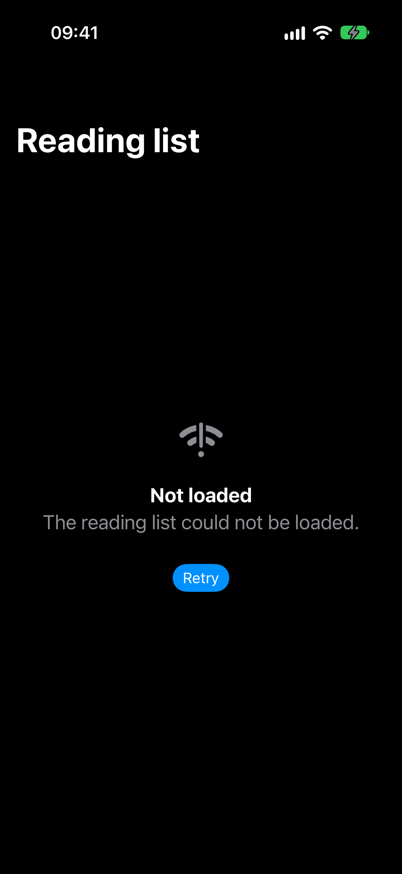
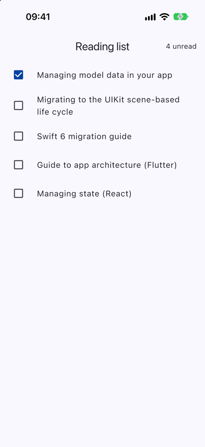
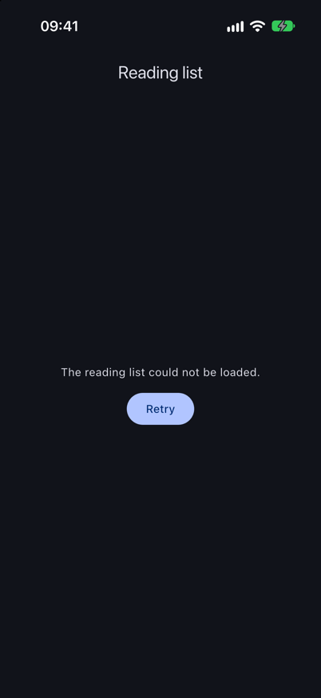
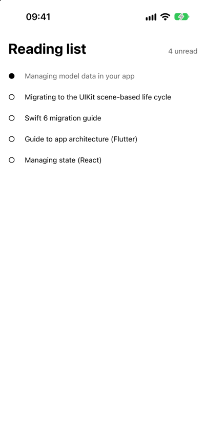
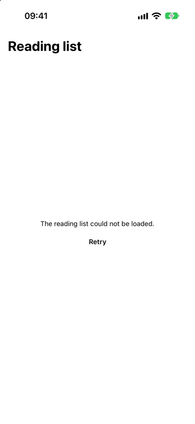

# Examples: one feature in three stacks

The same small feature, a reading list, built three times with the structure the platform guides
in the list recommend. Read them side by side to see how the ideas map from Swift to Dart to
TypeScript; none of them needs a third-party library.

| Folder                                                       | Stack                                            | State holder                                          | Tests                                                        |
| ------------------------------------------------------------ | ------------------------------------------------ | ----------------------------------------------------- | ------------------------------------------------------------ |
| [ios/ReadingList](ios/ReadingList)                           | Swift 6, SwiftUI, Observation (iOS 17, macOS 14) | `@Observable` `ReadingListModel` on the main actor    | 12 Swift Testing tests, macOS and iOS simulator              |
| [ios/ReadingListApp](ios/ReadingListApp)                     | SwiftUI `App` using the package                  | the same model                                        | built for the iOS simulator in CI                            |
| [flutter/reading_list](flutter/reading_list)                 | Flutter, Dart 3                                  | `ChangeNotifier` `ReadingListViewModel`               | 13 unit and 3 widget tests                                   |
| [flutter/reading_list/example](flutter/reading_list/example) | Flutter `MaterialApp` using the package          | the same view model                                   | analysed in CI; run on the iOS simulator for the screenshots |
| [react-native/reading-list](react-native/reading-list)       | React Native 0.88, React 19, TypeScript          | framework-free store read with `useSyncExternalStore` | 15 Vitest tests; screen and `example/App.tsx` type-checked   |

<p align="center">


</p>

<p align="center">


</p>

<p align="center">


</p>

## The feature

Each version implements the same rules, and each test suite checks all of them:

1. **States.** The screen is in exactly one of: idle, loading, loaded (a list of articles),
   empty, or failed (a message). Each stack models this as a closed type (Swift `enum`, Dart
   `sealed class`, TypeScript discriminated union), so the view must handle every case.
2. **Loading.** `load()` while a load is running does nothing, so a double tap on Retry or a
   screen that appears twice sends one request.
3. **Failures.** A failed load shows a fixed sentence, never the error's own text, which can
   contain URLs, server messages or tokens.
4. **Optimistic toggle.** Marking an article as read changes the screen at once and saves in the
   background. When the save fails, only that article is put back and a short message appears;
   toggles of other articles made in the meantime are kept.
5. **One save per article.** A toggle on an article whose save is still running is ignored, so
   saves for one article can never finish out of order.
6. **Invalid input.** A toggle on an unknown article or while the list is not loaded does
   nothing.

The view only renders state and forwards taps, and the data layer sits behind an interface
(`ArticleRepository`), so the tests replace it with a fake whose calls stay pending until the
test completes them. That makes the order of completion part of the test instead of a matter of
timing.

## Run them

```sh
# iOS: tests on macOS, then on an iOS simulator
cd Examples/ios/ReadingList
swift test
xcodebuild test -scheme ReadingList -destination 'platform=iOS Simulator,name=iPhone 17 Pro'

# Flutter
cd Examples/flutter/reading_list
flutter test

# React Native
cd Examples/react-native/reading-list
npm ci && npm run typecheck && npm test
```

Open `Examples/ios/ReadingListApp/ReadingListApp.xcodeproj` in Xcode to run the iOS app. Launch
arguments `-scenario empty` and `-scenario failed` show the other states;
[scripts/capture-ios-example.sh](../scripts/capture-ios-example.sh) uses them to take the
screenshots above on a simulator.

`Examples/flutter/reading_list/example` runs the Flutter feature as an app with the same three
scenarios, chosen with `--dart-define=SCENARIO=empty` or `failed`. It keeps only the Dart code;
[scripts/capture-flutter-example.sh](../scripts/capture-flutter-example.sh) adds the iOS runner
with `flutter create` in a build folder and takes the Flutter screenshots on the same simulator.

`Examples/react-native/reading-list/example/App.tsx` mounts the React Native screen in an app and
reads the same `-scenario` launch argument on iOS.
[scripts/capture-react-native-example.sh](../scripts/capture-react-native-example.sh) makes an app
from the official React Native template in a build folder, adds the feature and that component,
and takes the React Native screenshots from a Release build. The screen sets no colours of its
own, so it is shown in light appearance only.
