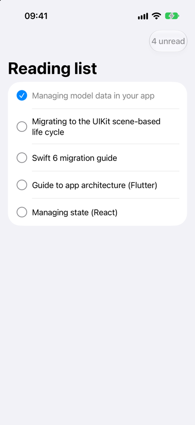
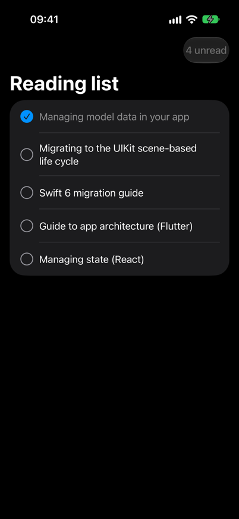

<!-- i18n-source: README.md@d993da6c400c808eb254c759491df673edfbf5ad status=reviewed -->
<!-- brand:start -->

<p align="center"><picture><source media="(prefers-color-scheme: dark)" srcset="https://raw.githubusercontent.com/muhittincamdali/awesome-mobile-architecture/main/.github/brand/banner-dark.svg"><source media="(prefers-color-scheme: light)" srcset="https://raw.githubusercontent.com/muhittincamdali/awesome-mobile-architecture/main/.github/brand/banner-light.svg"></picture></p>

<!-- lang-selector:start -->
<p align="center"><a href="README.md">English</a> · <a href="README.tr.md">Türkçe</a> · <a href="README.zh-CN.md">简体中文</a> · <a href="README.ja.md">日本語</a> · <a href="README.ko.md">한국어</a> · <a href="README.es.md">Español</a> · <a href="README.de.md">Deutsch</a> · <a href="README.fr.md">Français</a> · <a href="README.pt-BR.md">Português (Brasil)</a> · <a href="README.ru.md">Русский</a></p>
<!-- lang-selector:end -->

<p align="center">
<a href="https://github.com/muhittincamdali/awesome-mobile-architecture/actions/workflows/ci.yml"></a>
<a href="https://github.com/muhittincamdali/awesome-mobile-architecture/releases"><picture><source media="(prefers-color-scheme: dark)" srcset="https://raw.githubusercontent.com/muhittincamdali/awesome-mobile-architecture/main/.github/brand/badge-version-dark.svg"><source media="(prefers-color-scheme: light)" srcset="https://raw.githubusercontent.com/muhittincamdali/awesome-mobile-architecture/main/.github/brand/badge-version-light.svg"></picture></a>
<a href="https://github.com/muhittincamdali/awesome-mobile-architecture/blob/main/package.json"><picture><source media="(prefers-color-scheme: dark)" srcset="https://raw.githubusercontent.com/muhittincamdali/awesome-mobile-architecture/main/.github/brand/badge-language-dark.svg"><source media="(prefers-color-scheme: light)" srcset="https://raw.githubusercontent.com/muhittincamdali/awesome-mobile-architecture/main/.github/brand/badge-language-light.svg"></picture></a>
<a href="https://github.com/muhittincamdali/awesome-mobile-architecture/blob/main/LICENSE"><picture><source media="(prefers-color-scheme: dark)" srcset="https://raw.githubusercontent.com/muhittincamdali/awesome-mobile-architecture/main/.github/brand/badge-license-dark.svg"><source media="(prefers-color-scheme: light)" srcset="https://raw.githubusercontent.com/muhittincamdali/awesome-mobile-architecture/main/.github/brand/badge-license-light.svg"></picture></a>
</p>

<p align="center">
<a href="#クイックスタート"><picture><source media="(prefers-color-scheme: dark)" srcset="https://raw.githubusercontent.com/muhittincamdali/awesome-mobile-architecture/main/.github/brand/button-start-ja-dark.svg"><source media="(prefers-color-scheme: light)" srcset="https://raw.githubusercontent.com/muhittincamdali/awesome-mobile-architecture/main/.github/brand/button-start-ja-light.svg"></picture></a>
<a href="https://github.com/muhittincamdali/awesome-mobile-architecture/tree/main/docs/guides"><picture><source media="(prefers-color-scheme: dark)" srcset="https://raw.githubusercontent.com/muhittincamdali/awesome-mobile-architecture/main/.github/brand/button-guides-ja-dark.svg"><source media="(prefers-color-scheme: light)" srcset="https://raw.githubusercontent.com/muhittincamdali/awesome-mobile-architecture/main/.github/brand/button-guides-ja-light.svg"></picture></a>
<a href="https://github.com/muhittincamdali/awesome-mobile-architecture/tree/main/Examples"><picture><source media="(prefers-color-scheme: dark)" srcset="https://raw.githubusercontent.com/muhittincamdali/awesome-mobile-architecture/main/.github/brand/button-examples-ja-dark.svg"><source media="(prefers-color-scheme: light)" srcset="https://raw.githubusercontent.com/muhittincamdali/awesome-mobile-architecture/main/.github/brand/button-examples-ja-light.svg"></picture></a>
</p>

> このドキュメントは英語版 README の翻訳です。内容が異なる場合は英語版が最新です。

<!-- brand:end -->

iOS、Flutter、React Native アプリの構成方法に関するリンク集です。まず公式のガイダンス、次にそれを実践するライブラリ、サンプルアプリ、ツールを載せています。すべての項目は人が実際に開いて読んだもので、そこから何が得られるかを一行で添えています。毎週のジョブが、アーカイブされた、名前が変わった、または 540 日間更新されていないリポジトリと、応答しなくなったリンクを検出するため、リストが知らないうちに古くなることはありません。

## 主な特長

- **3 つのプラットフォーム、1 つの構成** — iOS、Flutter、React Native の各セクションは同じカテゴリで構成され、パターンの出どころとなるプラットフォーム非依存の記事も載せています。
- **すべてのリンクに理由があります** — 各項目に一行の「なぜ」を付けています。「最高」のような宣伝文句はチェッカーが拒否します。
- **集めただけでなく、確認済み** — 項目は [data/entries.json](data/entries.json) にあり、push のたびに検証され、この README に反映されます。GitHub のアクティビティとリンクの状態は毎週確認しています（[仕組み](docs/guides/keeping-the-list-current.md)）。
- **同じ機能を 3 つのスタックで** — SwiftUI、Flutter、React Native で作った[読書リストのサンプル](Examples/README.md)です。43 個のテストが、各プラットフォームで同じルールを確認します。
- **最新のプラットフォーム変更** — ネイティブ、Flutter、React Native の各アプリに求められる iOS 27 のシーンライフサイクルについての[ガイド](docs/guides/ios-27-scene-life-cycle.md)。

## クイックスタート

**1. プラットフォームを選びます。** [iOS](#ios)、[Flutter](#flutter)、[React Native](#react-native) のいずれかに移動します。まず *公式ガイダンス* の項目を読んでください。その下のライブラリはこれらの考え方の上に成り立っています。

**2. 使っているスタックのサンプルを実行します。** ガイドで説明している構成を、最小限で動かせる形にしたものです。

```sh
git clone https://github.com/muhittincamdali/awesome-mobile-architecture.git
cd awesome-mobile-architecture/Examples/flutter/reading_list   # or ios/ReadingList, react-native/reading-list
flutter test                                                  # swift test, or npm ci && npm test
```

**3. 必要な構成の度合いを決めます。** [アーキテクチャの選び方](docs/guides/choosing-an-architecture.md)では、3 つのプラットフォームに共通する考え方を整理し、TCA、Bloc、Redux Toolkit のようなライブラリが役に立ち始めるのはどんなときかを説明しています。

<p align="center">


</p>

<!-- list:start -->

## 目次

- [どこでも通用する考え方](#どこでも通用する考え方) (4)
- [iOS](#ios) (20)
- [Flutter](#flutter) (18)
- [React Native](#react-native) (15)

57 件。すべて手作業で開いて確認しています。最新の確認日は 2026-10-28 です。

## どこでも通用する考え方

### 公式ガイダンス

- [Guide to app architecture (Android)](https://developer.android.com/topic/architecture) - Google による UI 層、データ層、単方向データフローのガイド。同じ分け方が iOS、Flutter、React Native でも使われています。
- [Presentation Model](https://martinfowler.com/eaaDev/PresentationModel.html) - MVVM の元になったパターン。ビューの状態と振る舞いを、UI なしでテストできるクラスにまとめます。
- [The Clean Architecture](https://blog.cleancoder.com/uncle-bob/2012/08/13/the-clean-architecture.html) - レイヤー間の依存ルールを説明した原典の記事で、モバイル向けの Clean Architecture テンプレートの多くがこれを土台にしています。
- [The Elm Architecture](https://guide.elm-lang.org/architecture/) - Model、update、view。TCA、Redux、BLoC の背景にある単方向ループを、数ページで解説しています。

## iOS

### 公式ガイダンス

- [Discover Observation in SwiftUI](https://developer.apple.com/videos/play/wwdc2023/10149/) - Observation がビューの読み取るプロパティをどう追跡するかを解説した WWDC23 のセッション。現在の SwiftUI のビューモデルの基礎です。
- [Managing model data in your app](https://developer.apple.com/documentation/swiftui/managing-model-data-in-your-app) - `@Observable` モデルと、それを `@State`、`@Environment`、`@Bindable` で誰が所有するかについての Apple の解説です。
- [Migrating to the Observable macro](https://developer.apple.com/documentation/swiftui/migrating-from-the-observable-object-protocol-to-the-observable-macro) - `ObservableObject` のビューモデルを `@Observable` に移す具体的な修正と、ビューの更新がどう変わるかを示します。
- [Swift 6 migration guide](https://www.swift.org/migration/documentation/migrationguide/) - データ競合の安全性、`Sendable`、actor の分離を順を追って解説。Swift 6 のどのアーキテクチャも従うべきルールです。
- [TN3187 UIKit scene-based life cycle](https://developer.apple.com/documentation/technotes/tn3187-migrating-to-the-uikit-scene-based-life-cycle) - app delegate だけのアプリを `UIScene` に移行するための Apple のテクニカルノート。iOS 27 SDK でビルドするアプリは採用が必須です。

### 状態管理とアーキテクチャのライブラリ

- [Swift Async Algorithms](https://github.com/apple/swift-async-algorithms) - Debounce、throttle、merge など、ビューモデルで Combine のパイプラインに置き換えられる `AsyncSequence` のオペレーターです。
- [Swift Sharing](https://github.com/pointfreeco/swift-sharing) - 1 つのプロパティラッパーで、機能間の状態（user defaults、ファイル、メモリ）の共有と永続化ができます。
- [The Composable Architecture](https://github.com/pointfreeco/swift-composable-architecture) - reducer、effect、依存関係を 1 つのライブラリにまとめ、あらゆる状態変化を検証するテストストアを備えています。
- [Workflow (Swift)](https://github.com/square/workflow-swift) - UI を描画する Square の合成可能なステートマシン。Android アプリ向けに対応する Kotlin ライブラリもあります。

### 依存性の注入

- [Factory](https://github.com/hmlongco/Factory) - コンパイル時に検証される登録と、テストごとの上書きを備えたコンテナ型の注入。コード生成は不要です。
- [Needle](https://github.com/uber/needle) - Uber による、コードから生成されコンパイル時に検証される依存グラフ。多数のモジュールを持つアプリ向けです。
- [Swift Dependencies](https://github.com/pointfreeco/swift-dependencies) - ビューの外でも使える environment 方式の依存性注入で、テストごとにテスト用の値に差し替えられます。
- [Swinject](https://github.com/Swinject/Swinject) - オブジェクトスコープを持つ実行時コンテナ。起動時に依存関係を解決する UIKit のコードベースでよく使われます。

### ナビゲーション

- [Swift Navigation](https://github.com/pointfreeco/swift-navigation) - SwiftUI、UIKit、AppKit 向けの状態駆動ナビゲーション。遷移先はモデル内の optional または enum のケースです。
- [XCoordinator](https://github.com/QuickBirdEng/XCoordinator) - 型付きルートを使う UIKit 向けの Coordinator パターン。ビューコントローラー同士が push し合わずに済みます。

### サンプルアプリ

- [Clean Architecture for SwiftUI](https://github.com/nalexn/clean-architecture-swiftui) - SwiftData による永続化、ネットワーク、依存性注入、ユニットテストをレイヤーごとに分けた SwiftUI アプリです。
- [iOS Clean Architecture MVVM](https://github.com/kudoleh/iOS-Clean-Architecture-MVVM) - DI コンテナ、フローの coordinator、DTO のマッピング、レイヤーをまたぐレスポンスのキャッシュを備えた UIKit のテンプレートです。
- [TCA example apps](https://github.com/pointfreeco/swift-composable-architecture/tree/main/Examples) - ケーススタディに加え、Todos、Voice Memos、SyncUps、Search の各アプリがあり、ライブラリのリリースごとに更新されています。

### テスト

- [SnapshotTesting](https://github.com/pointfreeco/swift-snapshot-testing) - ビューや値を参照ファイルとして記録し、変化があれば失敗します。ユニットテストが見逃す UI の退行を検出します。

### プロジェクト構成とツール

- [Tuist](https://github.com/tuist/tuist) - Swift のマニフェストから Xcode プロジェクトを生成し、アプリが大きくなってもモジュールの境界を明確に保てます。

## Flutter

### 公式ガイダンス

- [Architecture case study](https://docs.flutter.dev/app-architecture/case-study) - Compass アプリを順に見ながら、ガイドを実際のコードにレイヤーごとに適用した様子を示します。
- [Architecture recommendations](https://docs.flutter.dev/app-architecture/recommendations) - 各推奨事項は「強く推奨」「推奨」「条件付き」で評価されているので、何が任意かがわかります。
- [Guide to app architecture (Flutter)](https://docs.flutter.dev/app-architecture/guide) - Flutter チームが推奨するレイヤー（UI、データ、任意の domain）を、ビュー、ビューモデル、repository で構成します。
- [State management options](https://docs.flutter.dev/data-and-backend/state-mgmt/options) - 状態管理の手法を一覧にした公式の索引。各パッケージ自身のドキュメントへのリンクがあります。
- [UIScene adoption](https://docs.flutter.dev/release/breaking-changes/uiscenedelegate) - `UIScene` が必須になったときに Flutter アプリの iOS ランナーで何が変わるか、どう移行するかを説明します。

### 状態管理とアーキテクチャのライブラリ

- [Bloc](https://github.com/felangel/bloc) - イベントを入れると状態が出てくる仕組み。ビジネスロジックを widget の外に置き、`bloc_test` でテストします。
- [Freezed](https://github.com/rrousselGit/freezed) - イミュータブルな状態クラス、sealed union、`copyWith` を生成し、状態オブジェクトの定型コードをなくします。
- [MobX for Dart](https://github.com/mobxjs/mobx.dart) - コード生成を使った observable、action、reaction。リアクティブな状態を好むチーム向けです。
- [Provider](https://github.com/rrousselGit/provider) - `InheritedWidget` を薄く包んだ層で、`ChangeNotifier` のモデルを注入します。Flutter の公式ドキュメントもこれから始まります。
- [Riverpod](https://github.com/rrousselGit/riverpod) - 非同期の状態、キャッシュ、依存性注入のためのコンパイル時に安全な provider。widget ツリーなしでテストできます。
- [Signals.dart](https://github.com/rodydavis/signals.dart) - Dart と Flutter 向けのきめ細かいリアクティブな signal。変更された値を読む widget だけを再構築します。

### 依存性の注入

- [get_it](https://github.com/flutter-it/get_it) - widget ツリーの外からも使える、repository やサービス用の service locator です。

### ナビゲーション

- [go_router](https://pub.dev/packages/go_router) - Flutter チームが保守している URL ベースの宣言的ルーティング。ディープリンク、リダイレクト、ネストされた navigator に対応します。

### サンプルアプリ

- [Bloc examples](https://github.com/felangel/bloc/tree/master/examples) - カウンター、タイマー、ログイン、ToDo、無限リスト、天気の各アプリ。いずれも bloc で作られ、テストでカバーされています。
- [Compass app](https://github.com/flutter/samples/tree/main/compass_app) - アーキテクチャガイドの元になった公式サンプル。ユニットテスト、widget テスト、インテグレーションテストを備えています。
- [Flutter architecture samples](https://github.com/brianegan/flutter_architecture_samples) - 1 つの ToDo アプリを BLoC、Redux、MobX、signal などで作ってあり、各手法を並べて比較できます。

### プロジェクト構成とツール

- [Melos](https://github.com/invertase/melos) - アプリを機能パッケージに分けたときに、Dart ワークスペース全体でスクリプトの実行、バージョン管理、公開を行います。
- [Very Good CLI](https://github.com/VeryGoodOpenSource/very_good_cli) - レイヤー構造、テスト、厳格な lint があらかじめ設定されたアプリとパッケージを作成します。

## React Native

### 公式ガイダンス

- [About the New Architecture](https://reactnative.dev/architecture/landing-page) - Fabric、TurboModules、JSI を解説します。0.76 以降、新しい React Native アプリが標準で使っているアーキテクチャです。
- [Managing State (React)](https://react.dev/learn/managing-state) - 状態の構成、リフトアップ、reducer や context への移し方についての React 自身のガイドです。
- [Testing overview](https://reactnative.dev/docs/testing-overview) - ユニットテスト、コンポーネントテスト、エンドツーエンドテストの公式の全体像と、それぞれがアプリのどの層をカバーするかを示します。

### 状態管理とアーキテクチャのライブラリ

- [Jotai](https://github.com/pmndrs/jotai) - アトミックな状態。1 つのグローバルストアではなく小さな atom を組み合わせ、計算値には派生 atom を使います。
- [Legend-State](https://github.com/LegendApp/legend-state) - 永続化を内蔵したきめ細かいリアクティブな状態管理で、データを端末に保存するアプリ向けです。
- [MobX](https://github.com/mobxjs/mobx) - 依存関係を自動で追跡する observable な状態。コンポーネントは、読み取った内容が変わったときだけ再レンダリングされます。
- [Redux Toolkit](https://github.com/reduxjs/redux-toolkit) - Redux を書く公式の方法。slice、代入のように書けるイミュータブルな更新、サーバーデータ用の RTK Query があります。
- [TanStack Query](https://github.com/TanStack/query) - サーバーデータを UI の状態とは別の専用の層で扱い、キャッシュ、再取得、リトライを提供します。
- [XState](https://github.com/statelyai/xstate) - チェックアウトやオンボーディングのように状態と遷移が多いフロー向けの、ステートマシンとステートチャートです。
- [Zustand](https://github.com/pmndrs/zustand) - provider が不要な、hook ベースの小さなストア。selector により、再レンダリングは変化した部分だけに限られます。

### ナビゲーション

- [Expo Router](https://docs.expo.dev/router/introduction/) - Expo と React Native アプリ向けのファイルベースのルーティング。すべての画面に URL が付き、ディープリンクが使えます。
- [React Navigation](https://github.com/react-navigation/react-navigation) - React Native 向けの stack、tab、drawer の navigator。Expo Router はこの上に作られています。

### サンプルアプリ

- [Ignite](https://github.com/infinitered/ignite) - Infinite Red のボイラープレートとジェネレーター。状態、ナビゲーション、テストを備えた完全なアプリ構成です。
- [Obytes React Native template](https://github.com/obytes/react-native-template-obytes) - Expo Router、React Query、フォーム処理、CI があらかじめ組み込まれた Expo と TypeScript のスターターです。

### テスト

- [React Native Testing Library](https://github.com/callstack/react-native-testing-library) - ユーザーがコンポーネントを見つけるのと同じ方法で検索するため、画面の裏側のコードをリファクタリングしてもテストが壊れにくくなります。

<!-- list:end -->

## 項目の選び方

項目は、アプリの構成に役立ち、人が実際に読んだ場合に追加します。人気があるからではありません。次の条件を満たす必要があります。

- 公式の情報源、または動作するコードでパターンを示すライブラリ、サンプル、記事であること。
- GitHub リポジトリの場合：アーカイブされておらず、過去 540 日以内に push があること。
- 読者が何を得られるかを平易な言葉で述べた一行の理由があること。

後からこれらの条件を満たさなくなった項目は、削除または差し替えます。既知の範囲外として、Android 専用の資料と Kotlin Multiplatform の資料は扱わず、有料コースも掲載しません。

## ガイド

- [モバイルアプリのアーキテクチャの選び方](docs/guides/choosing-an-architecture.md)
- [iOS 27 SDK と UIScene のライフサイクル](docs/guides/ios-27-scene-life-cycle.md)
- [リストを最新に保つ仕組み](docs/guides/keeping-the-list-current.md)

## コントリビューション

提案を歓迎します。項目を [data/entries.json](data/entries.json) に追加し、`npm ci && npm run list:render && npm test` を実行して pull request を作成してください。チェッカーが適用するルールは[コントリビューションガイド](CONTRIBUTING.md)に載っています。

## ライセンス

[MIT](LICENSE)。リンク先の内容は各作者のものであり、それぞれのライセンスに従います。
